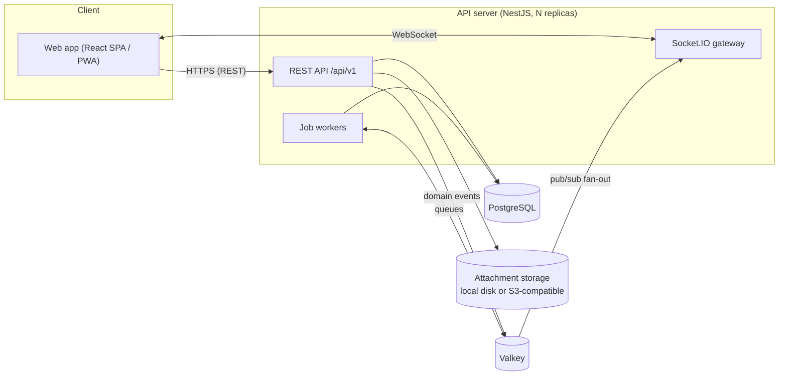
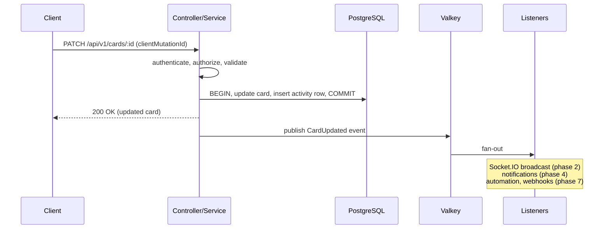
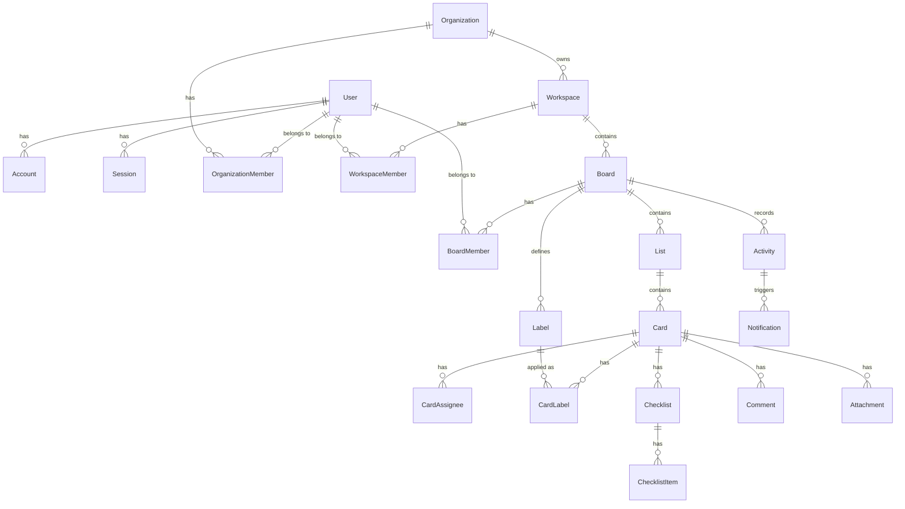

# Architecture

This document describes how Flowbit is structured. It is a **design draft**
written before implementation. It will be refined as each phase lands, and the
reasoning behind each choice is in [DECISIONS.md](DECISIONS.md).

## Contents

- [System overview](#system-overview)
- [Repository layout](#repository-layout)
- [Backend](#backend)
- [Frontend](#frontend)
- [Real-time sync](#real-time-sync)
- [Data model](#data-model)
- [Authorization](#authorization)
- [Multi-tenancy](#multi-tenancy)
- [Open-core boundary](#open-core-boundary)
- [Internationalization](#internationalization)
- [Deployment](#deployment)
- [Testing strategy](#testing-strategy)

---

## System overview



- **PostgreSQL** is the single source of truth.
- **Valkey** holds no durable state. It is used for real-time pub/sub across
  replicas, job queues, rate limiting, and caching.
- The **API server** is stateless and can run as several replicas behind a
  load balancer. In a minimal self-hosted setup a single process runs the REST
  API, the WebSocket gateway and the job workers, and also serves the built
  SPA.

---

## Repository layout

Monorepo structure (pnpm workspaces + Turborepo). Entries marked _(planned)_
arrive in later phases.

```
flowbit/
├── apps/
│   ├── api/                 # NestJS API server (AGPL-3.0)
│   │   ├── src/
│   │   │   ├── auth/        # Better Auth wrapper, session guard (D-020)
│   │   │   ├── workspaces/  # one folder per feature: controller, service, policy
│   │   │   ├── common/      # error format, validation pipes, OpenAPI helpers
│   │   │   ├── realtime/    # Socket.IO gateway, event publishing (planned)
│   │   │   └── jobs/        # background workers and schedulers (planned)
│   │   ├── prisma/          # schema.prisma, migrations
│   │   └── openapi.json     # generated API contract (committed)
│   └── web/                 # React SPA (AGPL-3.0)
│       ├── src/
│       │   ├── routes/      # TanStack Router file-based routes
│       │   ├── features/    # feature folders: auth, workspaces, layout, ...
│       │   ├── components/  # shared UI (shadcn/ui based)
│       │   ├── api/         # generated OpenAPI types + client
│       │   ├── realtime/    # socket client, cache patchers (planned)
│       │   └── i18n/        # en and ko message catalogs
│       └── e2e/             # Playwright end-to-end tests
├── packages/
│   └── shared/              # Zod schemas, domain types, constants, error codes
├── ee/                      # Enterprise features (commercial license)
│   ├── LICENSE
│   ├── api/                 # NestJS modules: sso, scim, audit, policies (planned)
│   └── web/                 # enterprise UI screens (planned)
├── docker/                  # Dockerfile, entrypoint
├── scripts/                 # repository tooling (license check)
└── docs/
```

Shared TypeScript, ESLint and Prettier configuration lives at the repository
root (`tsconfig.base.json`, `eslint.config.js`, `.prettierrc.json`).

---

## Backend

### Module structure

Each feature is a NestJS module with three layers:

- **Controller:** HTTP routes, request validation (Zod or class-validator),
  OpenAPI metadata. Contains no business logic.
- **Service:** business rules and permission checks. It runs inside a
  transaction and emits domain events.
- **Repository / Prisma access:** queries. Every query is tenant-scoped.

Cross-cutting concerns are handled by NestJS guards (authentication and
authorization), interceptors (logging, `clientMutationId` propagation) and
exception filters (mapping errors to stable error codes).

### Write path

Every mutation follows the same pattern, which is what makes real-time,
activity logs, notifications, automation and webhooks possible without
special cases:



- The activity row is written **in the same transaction** as the change, so
  the activity log can never miss a change.
- Events are published **after commit**. If reliable delivery to external
  consumers such as webhooks becomes necessary, we will move to a
  transactional outbox (an `outbox` table plus a relay worker).

### API conventions

- Base path `/api/v1`. Resources are nested only one level where it helps,
  e.g. `/boards/:boardId/lists`.
- Cursor-based pagination: `?cursor=...&limit=...`.
- Error body: `{ "error": { "code": "BOARD_NOT_FOUND", "message": "...", "details": {} } }`.
  The `code` values are stable and defined in `packages/shared`.
- Each mutating request may include a `clientMutationId` header. It is echoed
  in the response and in the resulting real-time events.
- The OpenAPI spec is generated at build time and the web client is generated
  from it, so the spec is the contract.

---

## Frontend

- **Routing:** TanStack Router, with type-safe routes. A card detail page is
  a route (`/b/:boardId/c/:cardId`), so it can be linked and shared.
- **Server state:** TanStack Query. Query keys are scoped by entity (e.g.
  `['board', boardId]`). Real-time events update the cache in place instead
  of refetching.
- **Local UI state:** React state. A small store (e.g. Zustand) is added only
  if a real need appears.
- **Optimistic updates:** drag and drop and inline edits update the cache
  immediately and roll back if the server returns an error.
- **Components:** shadcn/ui (copied into the repo) on Radix primitives,
  styled with Tailwind, with light and dark themes and responsive layouts.
- **Drag and drop:** dnd-kit, with sensors for mouse, touch and keyboard. A
  dropped item gets a new fractional-index key between its neighbours.

---

## Real-time sync

See [D-010](DECISIONS.md#d-010-real-time-sync-over-websockets) for the levels
and the phase each one lands in.

- **Connection:** The client opens one Socket.IO connection after sign-in,
  authenticated with the same session.
- **Rooms:** When a board page opens, the client joins `board:{boardId}`. The
  server checks read access before allowing the join. User-level events
  (notifications) go to `user:{userId}`.
- **Events:** Each event has the form
  `{ type, boardId, entity, data, actorId, clientMutationId, version }`, where
  `type` is something like `card.updated`, `card.moved` or `list.created`.
- **Echo suppression:** A client ignores events that carry a
  `clientMutationId` it generated itself, because it already applied that
  change optimistically.
- **Ordering and staleness:** Every mutable entity has an integer `version`
  that increases on each update. The client drops events older than the
  version it has in cache.
- **Reconnect:** After a reconnect, the client refetches the active board to
  catch up. Event replay is not planned.
- **Scale-out:** The Socket.IO Valkey adapter delivers events to clients
  connected to any replica.

---

## Data model

This is a draft of the core entities. Field lists are indicative, and the
Prisma schema will be the source of truth. All IDs are UUIDv7 (sortable by
time). All tables have `createdAt` and `updatedAt`. Mutable domain entities
also have `version`.



### Identity and tenancy

| Entity               | Key fields                                                                                             | Notes                                                                                                           |
| -------------------- | ------------------------------------------------------------------------------------------------------ | --------------------------------------------------------------------------------------------------------------- |
| `User`               | email (unique), name, image?, emailVerified, locale                                                    | Managed by Better Auth ([D-020](DECISIONS.md#d-020-better-auth-behind-our-own-auth-module)); `locale` is ours   |
| `Account`            | userId, providerId (`credential`, `github`, `google`, later `sso`), accountId, password?, OAuth tokens | One per sign-in method. The password hash lives on the `credential` account                                     |
| `Session`            | userId, token (unique), expiresAt, userAgent, ipAddress                                                | Server-side sessions in PostgreSQL                                                                              |
| `Verification`       | identifier, value, expiresAt                                                                           | Email verification and password reset tokens                                                                    |
| `Organization`       | name, personalOwnerId? (unique)                                                                        | Each user gets one personal organization ([D-008](DECISIONS.md#d-008-organization--workspace--board-hierarchy)) |
| `OrganizationMember` | orgId, userId, role: `OWNER` \| `ADMIN` \| `MEMBER`                                                    |                                                                                                                 |
| `Workspace`          | organizationId, name, description?, createdById?, version                                              |                                                                                                                 |
| `WorkspaceMember`    | workspaceId, userId, role: `ADMIN` \| `MEMBER` \| `VIEWER`                                             |                                                                                                                 |
| `Invitation`         | scope (workspace or board), scopeId, email?, token, role, expiresAt                                    | Email or link invites (phase 3)                                                                                 |

### Boards and cards

| Entity          | Key fields                                                                                                                      | Notes                                                                                                     |
| --------------- | ------------------------------------------------------------------------------------------------------------------------------- | --------------------------------------------------------------------------------------------------------- |
| `Board`         | workspaceId, name, visibility: `PRIVATE` \| `WORKSPACE` \| `PUBLIC`, background, archivedAt?                                    |                                                                                                           |
| `BoardMember`   | boardId, userId, role: `ADMIN` \| `MEMBER` \| `OBSERVER`                                                                        |                                                                                                           |
| `List`          | boardId, name, position, archivedAt?                                                                                            | `position` is a fractional index ([D-015](DECISIONS.md#d-015-fractional-indexing-for-ordering))           |
| `Card`          | boardId, listId, title, description (Markdown), position, startAt?, dueAt?, dueCompletedAt?, coverId?, archivedAt?, createdById | `boardId` is denormalized for permission checks and real-time routing                                     |
| `CardAssignee`  | cardId, userId                                                                                                                  |                                                                                                           |
| `Label`         | boardId, name?, color                                                                                                           |                                                                                                           |
| `CardLabel`     | cardId, labelId                                                                                                                 |                                                                                                           |
| `Checklist`     | cardId, title, position                                                                                                         |                                                                                                           |
| `ChecklistItem` | checklistId, text, position, completedAt?, assigneeId?, dueAt?                                                                  |                                                                                                           |
| `Comment`       | cardId, authorId, body (Markdown), editedAt?, deletedAt?                                                                        |                                                                                                           |
| `Attachment`    | cardId, uploaderId, storageKey, fileName, mimeType, size                                                                        | Storage driver per [D-019](DECISIONS.md#d-019-attachment-storage-local-disk-or-any-s3-compatible-service) |
| `Watch`         | userId, boardId? or cardId?                                                                                                     | For notifications (phase 4)                                                                               |

### Activity and notifications

| Entity         | Key fields                                                  | Notes                                                      |
| -------------- | ----------------------------------------------------------- | ---------------------------------------------------------- |
| `Activity`     | boardId, cardId?, actorId, type, payload (JSONB), createdAt | Append-only, written in the same transaction as the change |
| `Notification` | userId, activityId, readAt?                                 | Fan-out from activity (phase 4)                            |

### Later phases (indicative)

- Phase 6 (`ee/`): `SsoConnection`, `VerifiedDomain`, `AuditLog`,
  `OrgPolicy`, `ScimToken`, `License`.
- Phase 7: `CustomField`, `CardCustomFieldValue`, `AutomationRule`,
  `AutomationRun`, `ApiToken`, `Webhook`, `WebhookDelivery`, `AiProvider`.

---

## Authorization

Authorization is checked in the service layer on every request. It is never
trusted from the client.

**Effective board access** is resolved in this order:

1. **Org `OWNER` or `ADMIN`:** full admin access to every workspace and board
   in the organization.
2. **Explicit `BoardMember` role:** `ADMIN`, `MEMBER` or `OBSERVER`.
3. **Workspace membership**, if the board's visibility is `WORKSPACE`:
   - Workspace `ADMIN` has the same access as a board `ADMIN`.
   - Workspace `MEMBER` has the same access as a board `MEMBER`.
   - Workspace `VIEWER` has the same access as a board `OBSERVER`.
4. **`PUBLIC` board:** read-only access for anyone, including anonymous users.
5. Otherwise, no access. The API responds with `404` (not `403`), so it
   doesn't reveal that the board exists.

| Capability                                                     | Observer | Member | Admin |
| -------------------------------------------------------------- | -------- | ------ | ----- |
| View board, cards, comments                                    | ✓        | ✓      | ✓     |
| Comment                                                        | —        | ✓      | ✓     |
| Create, edit and move cards and lists                          | —        | ✓      | ✓     |
| Manage labels                                                  | —        | ✓      | ✓     |
| Manage board members and settings, archive or delete the board | —        | —      | ✓     |

**Instance administrators** (phase 3,
[D-021](DECISIONS.md#d-021-instance-administrators-manage-accounts-not-content))
are a separate, server-wide role for account management. The role is **not**
part of the resolution above: it never grants access to organizations,
workspaces, boards or cards. An instance admin who needs to see content needs
an ordinary membership.

The permission logic lives in one place (a policy service in `apps/api`), and
its rules are covered by unit tests.

---

## Multi-tenancy

- **Model:** One shared database and schema. Every tenant-owned row resolves
  to exactly one `Organization` through the
  `Board → Workspace → Organization` chain.
- **Isolation:** Every query in the service and repository layer is scoped by
  that chain, and permission checks run before any data is returned. Tests
  include cross-tenant access attempts. PostgreSQL row-level security can be
  added later as defense in depth.
- **Self-hosted:** The same model applies. A small team usually has a single
  organization, and the UI hides the organization level
  ([D-008](DECISIONS.md#d-008-organization--workspace--board-hierarchy)).
- **SaaS:** Plan limits and billing attach to `Organization` (phase 6).

---

## Open-core boundary

[D-011](DECISIONS.md#d-011-open-core-licensing-agpl-30--commercial-ee)
defines the license split. The technical rules are:

- Code under `apps/` and `packages/` **must not import from `ee/`**. A lint
  rule enforces this.
- `ee/` code depends on the core and plugs in through explicit extension
  points:
  - **API:** an `EnterpriseModule` is registered dynamically at startup when
    `ee/` is present and a valid license key is configured. The core exposes
    hooks for auth providers, policy checks and audit sinks.
  - **Web:** a route and slot registry lets `ee/web` add settings pages and
    UI panels.
- Without `ee/`, or without a license key, the core runs fully featured for
  everything in phases 1–5 and the core parts of phase 7.

---

## Internationalization

- **Web:** i18next with namespaced JSON catalogs in `apps/web/src/i18n/{en,ko}/`.
  There are no hard-coded user-facing strings, and a lint rule flags literal
  strings in JSX.
- **API:** Errors carry stable `code`s, and the web client maps them to
  localized messages. Server-generated text such as emails and notification
  bodies is rendered in the recipient's `User.locale`.
- **Formatting:** Dates, times and numbers use `Intl` with the user's locale
  and time zone. Due dates are stored in UTC.

---

## Deployment

### Self-hosted (Docker Compose)

```
services:
  flowbit     # API server + built SPA + workers (one image)
  postgres    # PostgreSQL
  valkey      # Valkey
```

- All configuration goes through environment variables (database URL, Valkey
  URL, public URL, OAuth credentials, SMTP, storage driver, `ee/` license
  key).
- Attachments are stored on a mounted volume by default, or in an
  S3-compatible bucket if configured.
- Migrations run automatically on startup. This can be turned off for
  controlled upgrades.

### SaaS

- The same image runs with separate roles: `api`, `realtime` and `worker`
  processes, each scaled on its own.
- It uses a managed PostgreSQL and Valkey, S3-compatible object storage, and
  a CDN for the SPA's static assets.

---

## Testing strategy

| Level           | Tool                                                 | Scope                                                                                           |
| --------------- | ---------------------------------------------------- | ----------------------------------------------------------------------------------------------- |
| Unit            | Vitest                                               | Domain logic, permission policy, fractional indexing, shared schemas                            |
| API integration | Vitest + real PostgreSQL (Testcontainers or Compose) | Endpoints, transactions, tenant isolation                                                       |
| Real-time       | Vitest + Socket.IO client                            | Room authorization, event delivery, echo suppression                                            |
| End-to-end      | Playwright                                           | Critical user flows in Chromium (multi-browser later), including two-client real-time scenarios |
| License         | License checker in CI                                | [D-013](DECISIONS.md#d-013-permissive-only-dependency-policy)                                   |
